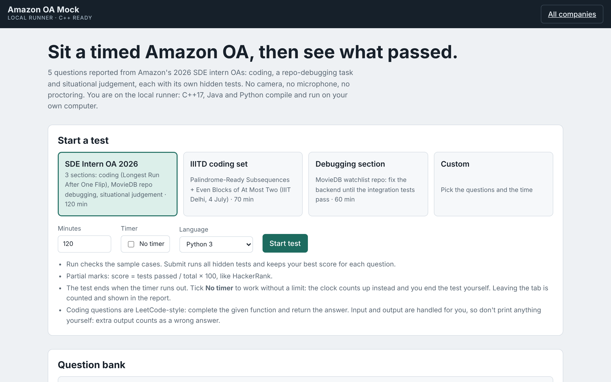
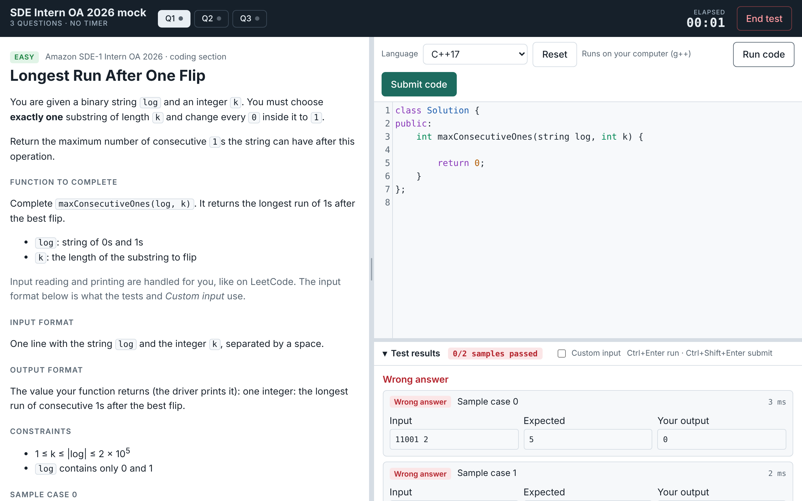
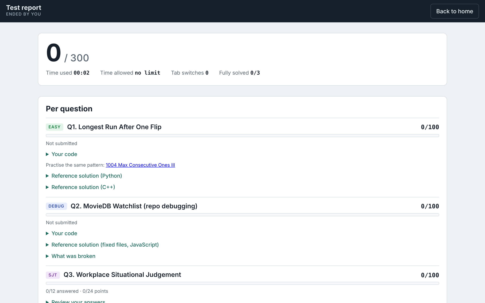
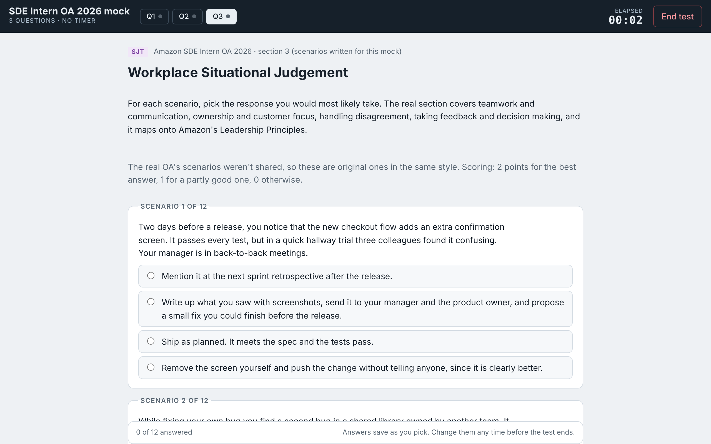
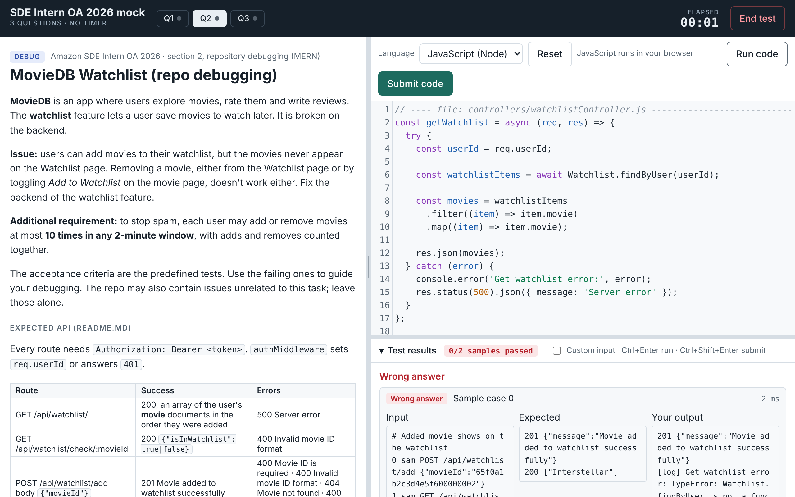

# OA Mock

**Practice online assessments for Flipkart, Juspay and Amazon on your own computer.** The tests use questions reported from real OAs, with hidden test cases, HackerRank-style partial marks and a scorecard at the end. You can sit a test timed or untimed.



- **Real formats:** each company's test layout is reproduced (for example, Amazon's 3-section SDE Intern OA), or you can build a custom set.
- **Your languages:** C++17, Java, Python 3 and JavaScript compile and run natively on your machine.
- **Graded like the real thing:** Run checks the samples, and Submit runs every hidden test. Score = tests passed / total × 100, and your best submission counts.
- **Timed or not:** a countdown that auto-submits, or **No timer** with a count-up clock.
- **Learn afterwards:** the report shows your code, reference solutions (Python + C++) and a LeetCode question with the same pattern.
- **Private:** no account, no camera, no proctoring. The runner only listens on `127.0.0.1`, and history is saved in your browser.

---

## Quick start

```
git clone https://github.com/rgabhi/oa-mock.git
cd oa-mock
```

| OS | First time | After that |
|---|---|---|
| **Windows 10/11** | double-click **`setup.bat`** | double-click **`start.bat`** |
| **macOS** | `./setup.sh` | `./start.sh` |
| **Linux** | `./setup.sh` | `./start.sh` |

The setup script installs whatever is missing, then opens **http://127.0.0.1:8765** in your browser.

| Tool | Needed for | Windows | macOS | Linux |
|---|---|---|---|---|
| Python 3.8+ | the mock itself (**required**) | `winget` Python 3.12 | python.org / Homebrew | package manager |
| C++ compiler | C++ answers | MinGW-w64 (WinLibs) via `winget` | Apple Command Line Tools* | `g++` |
| Java JDK | Java answers | Temurin 21 via `winget` | `brew install openjdk` | OpenJDK |

\*Apple clang works: the runner supplies `<bits/stdc++.h>` itself.

Linux setup supports apt, dnf, yum, pacman, zypper and apk (with `sudo`). Options:

```
./setup.sh --no-java      # skip the JDK
./setup.sh --no-start     # set up only, don't launch
setup.bat -NoJava -NoStart
```

**No scripts?** If you have Python, just run `python3 oa_mock_local.py` (`py oa_mock_local.py` on Windows). Set `OA_PORT=9000` to change the port.

---

## How a test works

1. **Pick a company and a format**, or press **Practise** on any question in the bank.
2. Set the **minutes**, or tick **No timer**.
3. **Run code** (`Ctrl+Enter`) checks the sample cases. **Submit code** (`Ctrl+Shift+Enter`) runs all hidden tests. Read from STDIN and write to STDOUT, as on HackerRank.
4. **End test** (or let the timer run out) to see the report. Tab switches are counted, like a proctored test.



| Report | Situational judgement |
|---|---|
|  |  |

---

## Question banks

### Amazon

| Section | Question | Source |
|---|---|---|
| Coding | Longest Run After One Flip (Easy) | SDE-1 Intern OA 2026 |
| Coding | Palindrome-Ready Subsequences (Medium) | 2026 Intern OA, IIIT Delhi, 4 July |
| Coding | Even Blocks of At Most Two (Hard) | 2026 Intern OA, IIIT Delhi, 4 July |
| Repo debugging | **MovieDB Watchlist (MERN)** | SDE Intern OA 2026, section 2 |
| Situational judgement | 12 workplace scenarios | Section 3 (scenarios written for this mock) |

Amazon's coding questions are **LeetCode-style**. You complete `class Solution` (or a function in JavaScript) in any of the four languages and return the answer. A hidden driver reads the input and prints your result, so Run, Submit and Custom input work as usual.

**Formats:** SDE Intern OA 2026 (all 3 sections, 120 min) · IIITD coding set (70 min) · Debugging section (60 min) · Custom.

The **repo-debugging** question recreates the real task. You get the watchlist controller, rate limiter and routes with the bugs reported from the OA: the list never shows added movies, removal doesn't delete, the status check returns the wrong type, and the "10 operations per 2 minutes" rate limiter is broken and not wired in. It runs against an in-memory Express/Mongo stand-in with 10 integration tests. Server logs appear as `[log]` lines.



The *Return/Risk Evaluation* repo task is listed but can't be run, because only an outline of it was reported.

### Flipkart

13 coding questions + 1 SQL (run on an in-browser SQL engine). Formats: **SDE**, **Data Engineer**, **UI Engineer**, Custom.

### Juspay

20 coding questions from HackerEarth, Rookies World, the Unstop hiring challenge and live elimination rounds. Formats: **Converging Maze**, **HackerEarth graph set**, **Unstop challenge**, **Elimination round**, Custom.

---

## Troubleshooting

| Problem | Fix |
|---|---|
| `OSError: Address already in use` | An older runner is still running, often because **Ctrl+Z** paused it instead of stopping it. Run `kill %1` or `lsof -ti tcp:8765 \| xargs kill`. The runner also falls back to the next free port. Always stop it with **Ctrl+C**. |
| "No C++ compiler found" | Run setup again. On Windows, open a **new** terminal after installing so `g++` is on your PATH. On macOS, finish the Command Line Tools installer and re-run `./setup.sh`. |
| Java not detected on macOS | `brew install openjdk`, then run the `sudo ln -sfn …` command that brew prints. |
| Page opened as a file, not through the runner | Python and JavaScript still work in the browser, but C++ and Java need the runner. Start `oa_mock_local.py` and use the `127.0.0.1` address. |

---

## Repository layout

```
oa_mock_local.py      the runner: a stdlib-only Python web server with all three test pages embedded
setup.sh              macOS / Linux setup
setup.ps1, setup.bat  Windows setup (double-click the .bat)
start.sh, start.bat   launchers
docs/                 screenshots
Amazon SDE 2026 OA.pdf, PDF Gallery_*.pdf, mock_amazon.txt   source notes for the Amazon bank
```

The questions are paraphrased from candidates' reports and are for personal practice only.
